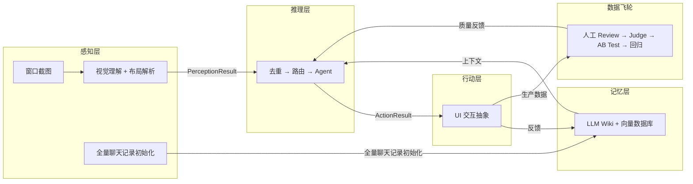
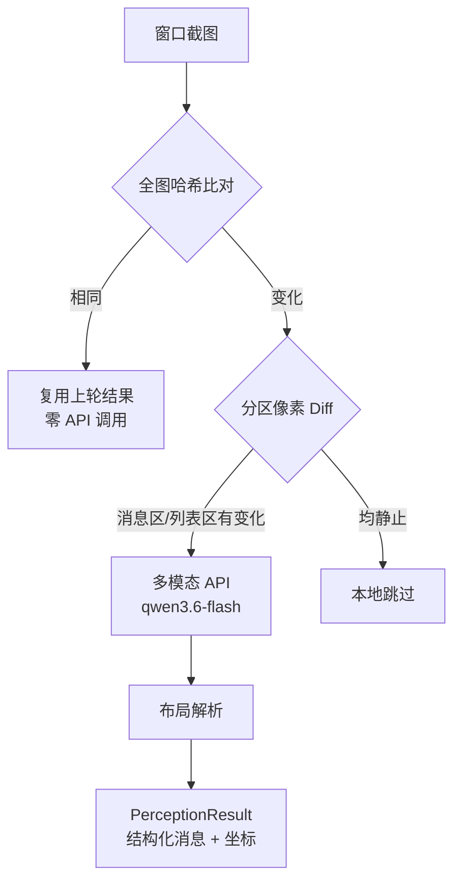
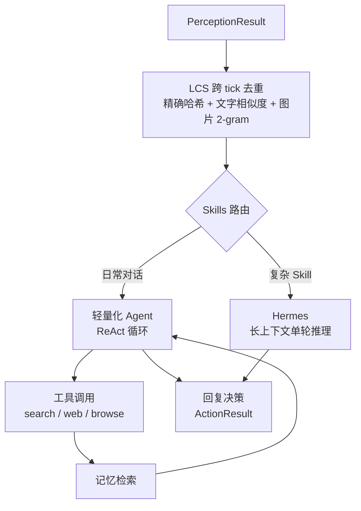
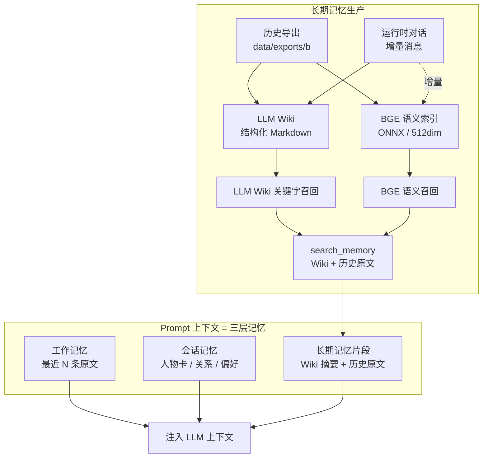
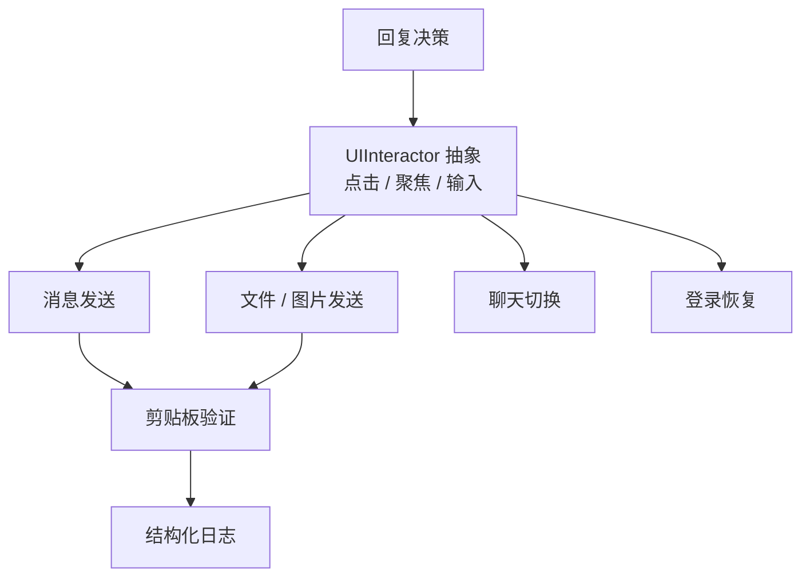
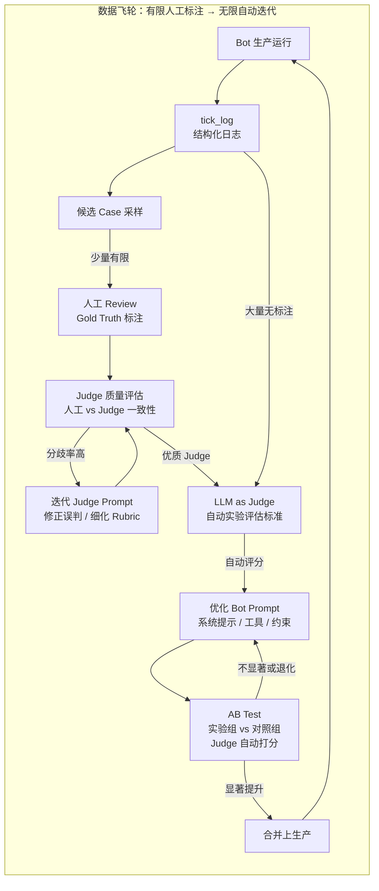
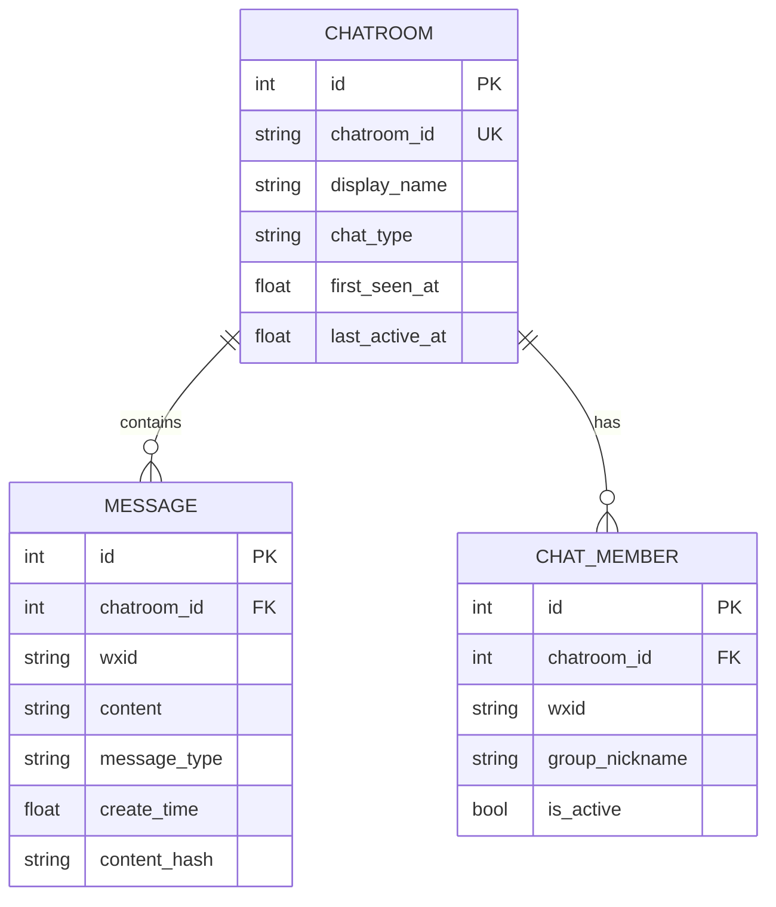

# WeChat Mac RPA


**中文** | [English](README_EN.md)

通过 TraceMemo 本地 HTTP API 接收微信消息，或选择原有 OCR / SmartPipeline 视觉方案，自动生成回复。默认使用 TraceMemo，发送仍复用微信 GUI 操作。

基于可切换的**消息感知**与**LLM Agent**的 macOS 微信自动化框架。视觉模式读取界面；TraceMemo 模式读取用户已授权连接的本地数据库。两种模式共用回复、人设、记忆和发送逻辑。

核心设计：**感知 → 推理 → 行动 → 记忆 → 数据飞轮**，五个子系统构成完整的认知闭环。每一次认知循环的完整链路都被结构化日志逐条记录，形成**可追溯、可回归、可量化**的生产质量资产。

---

## 快速开始

MuMu 模拟器 Python 工具见 [src/mumu/README.md](src/mumu/README.md)，提供实例/App 管理、点击输入和 Android 原生截图；当前独立于微信 Bot 使用。

- **环境**：macOS 12+，Python 3.10+，微信 Mac 版
- **依赖**：`pip install -r requirements.txt`
- **配置**：复制 `.env.example` 为 `.env`，填入 API Key；复制 `prompts/persona.md.example` 为 `data/persona.md`，填写本地人设
- **隐私**：`.env` 与 `data/` 默认不进入 Git；不要把 API Key、聊天记录或真实人设提交到仓库
- **权限**：Bot 依赖 macOS 辅助功能/屏幕录制权限，详见下文[权限说明](#权限说明)
- **启动**：`python3 run_bot.py`（默认 TraceMemo，亦可显式指定 `--source tracememo`）
- **原视觉方案**：`python3 run_bot.py --source vision`
- **TraceMemo 准备**：启动 TraceMemo 并连接数据库，将 API Token 配置到本机环境变量 `TRACEMEMO_API_TOKEN`（兼容旧变量 `WECHATEXPLORER_API_TOKEN`）；不要把 Token 提交到仓库。默认 API 地址为 `http://127.0.0.1:6131/api/v1`，可用 `TRACEMEMO_BASE_URL` 指定本机地址。
- **监听群**：`.env` 中配置 `TRACEMEMO_CHATS=群名或群ID,另一个群`，不配置则沿用 `SILENT_WHITELIST`。仅监听所列群，发送白名单规则保持有效；群不存在或存在同名歧义时拒绝启动。当前 TraceMemo 接收适配器仅支持群聊。
- **藏宝图开关**：`.env` 中 `ENABLE_TREASURE_MAP=0`（默认）关闭 Bot 藏宝图处理；设为 `1` 开启“藏宝图鉴别/添加”。重启生效。关闭时不加载图库、不下载或处理藏宝图图片，消息继续走普通处理流程；独立藏宝图 CLI 不受影响。
- **藏宝图添加**仅收录全开的图片。检测到未翻开的格子时，Bot 回复「该藏宝图未全开，不予收录」。全开图通过查重后才入库，CLI 的 `add` 也使用此规则。
- **藏宝图封面模板**放在父仓库根目录的 `cover_images/`，每张图裁成一个完整的未翻开格子，支持 PNG、JPEG、WebP。鉴别和添加都会逐格与模板对比。程序会在单格附近调整少量位置和尺寸，再比较已对齐的像素。对应像素的 RGB 各通道差值均不超过 28 时计为吻合。任一模板的吻合像素超过 90% 就判为未开。没有模板时会提示补充，放入后下次处理即生效。
- **接收行为**：每轮依次读取一个目标群，周期沿用 `POLL_INTERVAL`；启动前最近 30 分钟的消息仅用作上下文，不补回复历史。读取时间窗重叠 120 秒，按消息 ID 去重；API 故障时保留进度重试，不自动切换视觉。落库延迟超过重叠窗口的消息可能漏读。
- **媒体边界**：TraceMemo 模式读取文字、引用作者、消息类型及已有语音转写；图片、表情和视频仅保留未解析占位，尚未接入媒体识别。需要现有图片理解能力时使用 `--source vision`。
- **发送定位**：TraceMemo 可读取后台群消息；发送文字、文件或回复语音前，会打开并校验目标微信聊天，校验失败取消发送。微信仍须登录并可操作。
- **长时间挂机启动（推荐）**：`caffeinate -d .venv/bin/python run_bot.py`
  - 视觉模式靠截图读消息；TraceMemo 接收不依赖截图，但 UI 发送仍需窗口标题校验，建议保持显示器常亮
  - `caffeinate -d` 让显示器在 Bot 运行期间保持常亮，Bot 退出后恢复系统原设置
  - 手动锁屏、合上笔记本盖子仍会导致截图失败
- **管理后台（LaunchAgent 常驻）**：
  ```bash
  # 首次加载（用户登录时自动启动，崩溃自动重启）
  launchctl bootstrap gui/$(id -u) ~/Library/LaunchAgents/com.wechat-mac-rpa.admin.plist
  launchctl enable gui/$(id -u)/com.wechat-mac-rpa.admin
  launchctl kickstart gui/$(id -u)/com.wechat-mac-rpa.admin
  ```
  常用操作：
  - 查看状态：`launchctl list | grep com.wechat-mac-rpa.admin`
  - 手动重启：`launchctl kickstart -k gui/$(id -u)/com.wechat-mac-rpa.admin`
  - 停止服务：`launchctl bootout gui/$(id -u)/com.wechat-mac-rpa.admin`
  - 日志：`tail -f logs/admin-launchd.log logs/admin.log`
  - 前台调试用：`python3 scripts/admin.py`
- **测试**：开发环境先执行 `pip install -r requirements-dev.txt`，再运行 `python3 -m pytest src/tests -v`
- **OCR Benchmark**：`python3 scripts/benchmark_qwen_vl_ocr.py`
- **生成报告**：`python3 scripts/generate_ocr_benchmark_report.py`

详细安装与配置指南见 `docs/01-quickstart/AI_QUICKSTART.md`。

---

## 权限说明

Bot 通过 macOS 公开 API 与微信交互，需要以下系统权限：

| 权限 | 用途 | 设置位置 |
|------|------|---------|
| **屏幕录制** | `screencapture` 截取微信窗口画面 | 系统设置 → 隐私与安全 → 屏幕录制 → 终端/运行 Bot 的应用 |
| **辅助功能** | AppleScript 控制微信窗口（点击、输入、激活） | 系统设置 → 隐私与安全 → 辅助功能 → 终端/运行 Bot 的应用 |
| **自动化** | System Events 进程间通信（keystroke、click） | 首次运行时会弹窗授权 |

> 如果截图失败、点击无效或消息发到其他应用，请首先检查上述权限是否已授予。
> 权限必须授予**实际启动 Bot 的应用**。生产运行建议使用普通终端或 LaunchAgent；不要直接从 Codex、Claude Code 等自动化开发环境启动。截图失败时可先运行 `screencapture -x /tmp/wechat-test.png`：如果系统截图也失败，应先排查宿主权限或微信运行环境，而不是修改项目截图逻辑。

---

## 系统架构

### 总览：五层认知闭环



---

### 感知层：把像素变成结构化数据

感知层的任务是**忠实还原界面上的文字、布局和状态**，不"理解"对话，只负责提取。

当前两条感知管道并行运行：

- **SmartPipeline**（主力）：本地预判 + 多模态 API 兜底。先用像素 Diff 判断截图是否有实质变化，无变化时零 API 调用直接跳过；有变化时调用多模态大模型提取消息内容。
- **VisionPipeline**（Fallback）：纯本地 OCR 备用管道，在多模态 API 不可用时降级运行。

WeFlowPipeline 不直接参与感知，而是作为**记忆系统的初始化来源**：启动时从微信数据库导出全量历史聊天记录，按聊天聚合后注入 GlobalStore，让 Bot 上线第一天就拥有完整的背景知识。



---

### 推理层：决定说什么、用什么工具

推理层是 Bot 的"大脑"。它不直接操作界面，只决定**说什么**和**用什么工具**。

核心设计是**二级路由**：先用轻量调用判断用户意图是否匹配某个复杂 Skill，再决定投入哪条推理路径。

- **轻量化 Agent**（日常路径）：运行完整的 ReAct 循环——分析意图 → 调用工具 → 观察结果 → 重新推理。Agent 自行决定调用 `search_memory`、`web_search`、`browse_url` 等工具，也可以加载 Skills 进行深度组合推理。
- **Hermes 路径**：匹配到复杂 Skill 且 Hermes 模型可用时，切换长上下文模型，加载完整 Skill 正文进行单轮深度推理，不启用 ReAct 工具循环。



感知层以固定间隔输出一帧消息列表，但聊天历史不会消失——大部分消息在上一轮已经见过。如果 Bot 把旧消息当成新消息，就会重复回复。我们用 **LCS（最长公共子序列）**做跨 tick 消息对齐，对齐基于多维度模糊匹配：精确哈希匹配、文字相似度、图片 2-gram Jaccard 相似度。对齐后只有真正的新消息进入后续流程，旧消息被静默丢弃。

---

### 记忆系统：三层记忆构成完整上下文

Bot 的 prompt 不是只依赖长期 Wiki，而是由**三层记忆**共同组装：工作记忆提供即时上下文，会话记忆提供人物与关系，长期记忆提供跨时间的背景知识。

```
Prompt = 工作记忆（最近对话原文） + 会话记忆（人物 / 关系 / 偏好） + 长期记忆（Wiki / 向量召回）
```

#### 工作记忆（Working Memory）

工作记忆是 Bot 对当前对话的即时感知，通常取**最近 N 条对话原文**（如最近半小时或最近 20 条）。它解决的是"刚才说了什么"的问题：

- 未完成的用户意图与追问链
- 最近的指代、省略、上下文依赖
- 当前活跃的语气、节奏与话题边界

工作记忆直接从 session 存储中按时间窗口截断获取，不做复杂召回，保证时效性和准确性。

#### 会话记忆（Session Memory）

会话记忆描述**当前对话对象和当前会话状态**，通常从长期记忆中实时召回后，以"人物卡"形式固定在 prompt 顶部：

- **基础画像**：对方姓名、身份、与 Bot 的关系（如同事、朋友、家人）
- **社会关系**：家庭成员、同事圈、共同群聊、亲疏层级
- **用户偏好**：沟通风格、常用表达方式、敏感话题、历史忌口
- **会话状态**：当前活跃话题、待跟进事项、已确认/待确认的信息

这一层让 Bot 知道"对面是谁"、"我和ta什么关系"、"现在聊到哪了"。

#### 长期记忆（Long-term Memory）

长期记忆跨越单次会话，保存时间线更长的背景知识。它把 **历史聊天记录** 当作原始输入数据，向上抽象出两个索引层：

- **LLM Wiki**：由 LLM 从原始对话中提炼、结构化的长期事实（按联系人/群聊独立维护），增量更新，标注来源。
- **BGE 语义索引**：对原始对话做 `BAAI/bge-small-zh-v1.5` 嵌入，提供语义级历史原文检索。

**原始输入数据**
- **历史导出**：`data/exports/b/` 下的 JSON 消息导出文件。
- **运行时对话**：Bot 收到的新消息，可通过 `history_search.add_message()` 实时加入检索。

**索引构建**

```bash
# 首次全量构建（约 1 小时）
python3 scripts/update_history_index.py

# 后续单条增量（管理工具）
python3 scripts/update_history_index.py \
  --add-one '{"id":"...","text":"...","sender":"...","chat_type":"single"}'
python3 scripts/update_history_index.py --remove-one "MSG_ID"
```

- 编码器使用 **ONNX Runtime**，无需 `torch` / `transformers`。
- 默认模型路径为仓库内的 `models/bge-small-zh-v1.5`，可通过 `WECHAT_BGE_MODEL_PATH` 覆盖。
- 输出 `data/memory/cache/vector_index_dense_messages.pkl`，可通过 `WECHAT_HISTORY_INDEX_PATH` 覆盖。

**线上召回**

- **`search_memory` 工具**：同时召回：
  - **LLM Wiki 摘要**：人物/群聊的关键事实与关系。
  - **历史聊天原文**：语义相似的原始对话片段（含上下文）。
- 语义索引支持运行时单条增量：`history_search.add_message(msg)` 先写入内存缓冲区，检索时与持久化主索引合并；需要持久化时可通过 `--add-one` 写回 pkl。

**人工 Overrides**：通过外挂 JSON 实现任意字段覆写，LLM 更新时不会破坏人工修改。

聊天记录、记忆索引等持久化数据保存在本地。启用外部 LLM / 多模态 API 时，完成推理所需的对话 Prompt 或微信截图会发送给所配置的 API 服务商。



---

### 行动层：把文本变成界面操作

行动层负责把推理层的决策翻译成对微信 GUI 的实际操作。面对不稳定的 GUI 环境（窗口可能被遮挡、焦点可能丢失、剪贴板可能被污染），我们用 **UIInteractor** 抽象所有坐标级交互，上层 Action 基于该抽象实现，便于替换底层自动化方案。

行动层目前覆盖四类核心动作，均基于同一套 UI 抽象，内置安全机制（frontmost 验证、异常熔断、剪贴板清理）：

- **消息发送**：文本通过 AppleScript 写入剪贴板并粘贴到输入框，发送前做剪贴板内容回读验证。
- **文件/图片发送**：文件通过 AppleScript 将 POSIX 文件对象设置到剪贴板，再粘贴发送；图片发送复用同一剪贴板通道。`send_file` 作为动态工具向 Agent 暴露，可发送 `data/shareable_files.json` 白名单中的文件。
- **聊天切换**：从感知层获取左侧聊天列表项，坐标转换后调用 `cliclick` 点击目标聊天；加入 1 秒全局点击冷却，避免高频连点导致微信窗口布局异常。
- **登录恢复**：检测扫码/掉线弹窗，自动点击登录按钮并等待重连。

Bot 每个 tick 检测并切换到未读数最高的聊天逐个处理，同一目标在短时间内不会重复切换。



---

### 数据飞轮：有限人工标注，无限自动迭代

数据飞轮的精髓不是"人来一条一条修 badcase"，而是**用有限的人工标注成本，换一瓶优质的 LLM as Judge；再用这瓶 Judge 作为自动实验评估标准，无限地迭代 Bot**。

人工 review 是稀缺资源，所以只投在最关键的地方——校准 Judge。一旦 Judge 的打分与人工判断足够一致，它就能接管后续所有 Bot 实验的评估工作：每天产生的大量 tick_log、每一次 prompt 改动、每一个路由策略调整，都可以让 Judge 自动评分，不再需要人逐条过目。



#### 设计思想：Judge 就是 Reward Model

这个数据飞轮的设计思想与 **On-Policy 强化学习**非常相似：

| 数据飞轮 | 强化学习 |
|---|---|
| 少量人工标注 | 人类偏好监督数据 |
| LLM as Judge | Reward Model |
| Bot 回复生成 | Actor |
| Prompt / 工具 / 约束优化 | 策略更新 |
| 新策略上线后继续生产 tick_log | On-Policy：新策略采样新数据 |

区别只在于，这里的 Actor 优化不是通过梯度更新模型参数，而是通过人工分析 reward 信号、调整 prompt / 工具 / 约束等"策略配置"，再用 AB Test 验证新策略是否确实提升了 reward。所以这是一个**人工设计策略 + 自动评估验证**的 on-policy 循环：新策略上线后继续产生新的 tick_log，再采样、标注、校准 Judge，周而复始。

这个类比也解释了为什么 Judge 的质量如此关键：**一个带偏的 Reward Model 会把 Actor 带偏**。只有 Judge 足够可信，Bot 的迭代方向才不会歪。

#### 回路一：用有限人工标注校准 Judge

人工 review 只发生在回路一，且是**少量、有策略的采样标注**。每一例人工标注都被同时用于两件事：训练我们自己对 case 的判断标准，以及评估 Judge 是否跟上了这个标准。

- **Judge 质量评估**：持续对比人工标注与 Judge 评分，计算一致性、误判率、分歧率。分歧率就是 Judge 这瓶"度量衡"的误差。
- **Judge Prompt 迭代**：当分歧率超过阈值时，暂停 Judge 自动评估，分析典型误判模式，迭代 Judge 的 Rubric、示例和边界定义——不是让 Judge 去拟合某一条 case，而是让它的评分标准更贴近人的真实偏好。
- **回归验证**：更新后的 Judge 必须先在 **Judge Quality benchmark** 上通过回归验证，确认它既没有丢失旧能力、也没有引入新偏见，才能重新作为实验评估标准。

#### 回路二：用优质 Judge 无限迭代 Bot

Judge 一旦可信，回路二就可以大规模自动化运转，**人工不再参与逐条评估**。

- **自动质量评估**：每天的生产 tick_log 由 Judge 自动打分，筛选出值得关注的候选 case 供下一轮少量人工抽检；AB Test 中的实验组与对照组由同一版 Judge 评分，保证评估口径一致。
- **根因分析**：从 Judge 评分和抽检样本中提取共性问题，定位是系统提示、工具定义、约束条件还是记忆召回出了问题。
- **通用规则修复**：禁止 case-by-case 打补丁。所有修复必须表达为可复用的规则或配置变更，并在 benchmark 上验证。
- **AB Test 验证**：任何提示词、模型、路由策略的改动，必须先跑 AB Test。只有实验组相比对照组显著提升才允许合并上生产；不显著或退化则回炉重优化。

这就是数据飞轮的杠杆：**人在回路一中投入的每一分钟，都在放大回路二的自动化能力**。Judge 越准，Bot 迭代越快、人工投入越少。

---

## 工程基础设施

- **Benchmark Dashboard**：自动生成可视化报告，汇总各 benchmark 的历史趋势与当前状态
- **管理后台**：内置 FastAPI 开发者后台（`scripts/admin.py`），提供 Dashboard、Tick 查看、人工标注、截图 OCR、Benchmark 报告、实验管理
- **全链路 Profile**：整个链路植入统一的性能打点，覆盖截图、OCR、布局、生成、记忆、发送各阶段

---

## Benchmark

| Benchmark | 结果 |
|-----------|-----:|
| **Reply Quality** | **91.7%**（22/24） |
| **Tool Decision · 常规** | **100%**（22/22） |
| **Memory Search** | **96.6%**（28/29） |
| **OCR · 代表性场景通过率** | **93.1%**（27/29） |
| **OCR · Chat Name** | **96.6%** |
| **OCR · Message Count** | **93.1%** |
| **OCR · Sender** | **93.6%** |
| **OCR · Text** | **93.5%** |

---

## 项目结构

```
wechat-mac-rpa/
├── src/
│   ├── bot/               # L5: 主循环编排
│   ├── perception/        # L3.5: SmartPipeline / VisionPipeline / WeFlowPipeline
│   ├── layout/            # L3: 布局解析
│   ├── message/           # L3: 消息提取
│   ├── session/           # L4: 全局消息存储（LCS 去重 + 持久化）
│   ├── reply/             # L4: 回复生成（Agent 运行时 + 双模型路由）
│   ├── memory/            # L4: 记忆系统（工作 / 会话 / 长期记忆 + LLM Wiki + Overrides）
│   ├── tools/             # L4: 工具注册 + 内置工具
│   ├── action/            # L4: UI 交互 / 消息发送 / 聊天切换 / 登录恢复
│   ├── capture/           # L2: 窗口截图
│   ├── ocr/               # L2: macOS Vision 文字识别
│   ├── models/            # L1: 领域模型
│   ├── db/                # L1: SQLite 数据模型与 Repository（聊天记录唯一权威源）
│   ├── llm/               # LLM 客户端（Kimi 本地代理 / DashScope API）
│   ├── logging/           # 结构化日志与全链路追踪
│   ├── utils/             # L1-L5 共享工具
│   ├── badcase/           # Badcase 闭环（数据库 / 生成器 / Judge / 审核）
│   └── tests/             # 9 个 benchmark 套件 + 单元测试
├── tests_integration/     # 集成测试（真实截图 + 端到端）
├── scripts/               # 后台 / Dashboard 生成 / 实验框架 / 数据迁移
│   └── db/                # 数据库迁移、备份、去重脚本
├── docs/                  # 完整文档体系
│   ├── 01-quickstart/
│   ├── 02-architecture/
│   ├── 03-guides/
│   ├── 04-troubleshooting/
│   └── 05-meta/
├── data/                  # 运行时数据（gitignored）
│   ├── debug/             # tick 级 debug JSON
│   ├── logs/              # 运行日志
│   ├── screenshots/       # 截图存档
│   ├── memory/wiki/       # 用户/群聊/话题 wiki
│   ├── memory/cache/      # BGE 语义索引（vector_index_dense_messages.pkl）
│   ├── benchmark_history/ # Benchmark 历史数据
│   ├── experiments/       # 实验结果归档
│   └── cases.db           # Badcase 核心数据库
├── prompts/               # 系统 prompt 模板
├── skills/                # 可插拔 Skill（Markdown）
├── models/                # 模型配置与缓存
└── run_bot.py             # 生产环境入口
```

---

## 数据模型

运行时的聊天记录以 **SQLite** 为唯一权威源，`GlobalStore` 启动时从 DB 加载、保存时回写 DB，不再依赖易丢失的 JSON 分片。Phase 1 实现三张核心表：

| 表 | 说明 | 关键约束 |
|---|---|---|
| `chatrooms` | 聊天会话（群聊 / 私聊） | `chatroom_id` 全局唯一，解决同名群问题 |
| `messages` | 单条聊天消息 | `UNIQUE(chatroom_id, wxid, create_time, content_hash)` |
| `chat_members` | 群成员关系 | `UNIQUE(chatroom_id, wxid)` |



- 完整系统数据模型（含 `persons`、`aliases`、`facts`、`wiki` 等未来 Phase）见 [`docs/02-architecture/DATA_MODEL_SPEC.md`](docs/02-architecture/DATA_MODEL_SPEC.md)。
- Phase 1 MVP 详细设计见 [`docs/02-architecture/DATA_MODEL_PHASE1.md`](docs/02-architecture/DATA_MODEL_PHASE1.md)。
- 常用 DB 维护脚本：
  - `python scripts/db/migrate_exports_to_db.py`：批量导入导出文件到 DB
  - `python scripts/db/deduplicate_db.py`：按复合键去重
  - `python scripts/db/migrate_content_hash.py`：content_hash 算法迁移
  - `python scripts/db/backup_chat_db.py --retention 7`：自动备份与清理

---

## 核心术语

| 术语 | 说明 |
|------|------|
| **Tick** | Bot 主循环的一次迭代（当前启动入口间隔 15 秒；底层方法默认参数 5 秒），包含 感知 → 去重 → 决策 → 回复 |
| **Perception** | 感知层，将微信窗口截图转换为结构化数据（聊天名、消息列表、未读数等） |
| **Layout** | 布局解析，把 OCR 文字元素按 UI 区域分组（聊天列表、标题栏、消息区等） |
| **SmartPipeline** | 感知层实现之一：OCR + 视觉模型 API，带像素 diff 缓存，降低 API 调用频率 |
| **WeFlow** | 感知层实现之一：通过 WeChatDB 导出历史消息，用于首次全量初始化 |
| **GlobalStore** | 全局消息存储，负责跨 tick 去重、会话状态维护和持久化 |
| **Judge** | LLM-as-a-Judge，用于评估回复质量、自动标注 badcase |
| **Skill** | Markdown 格式的可插拔知识卡片，可被工具动态加载 |

## 文档索引

| 文档 | 说明 |
|------|------|
| [快速开始](docs/01-quickstart/AI_QUICKSTART.md) | 环境配置、依赖安装、首次启动 |
| [架构设计](docs/02-architecture/ARCHITECTURE.md) | L1-L5 分层架构、依赖规则、边界约束 |
| [数据模型 Phase 1](docs/02-architecture/DATA_MODEL_PHASE1.md) | SQLite DB-only 架构：chatrooms / messages / chat_members |
| [数据模型全量设计](docs/02-architecture/DATA_MODEL_SPEC.md) | 含 persons、aliases、facts、wiki 等未来 Phase 设计 |
| [API 接口速查](docs/02-architecture/API_SURFACE.md) | 当前生产代码的公共接口，可直接复制粘贴 |
| [模块索引](docs/02-architecture/MODULE_INDEX.md) | "消息识别错了"→改哪个文件 |
| [编码原则](docs/02-architecture/CODING_PRINCIPLES.md) | 类型注解、单一职责、单向依赖 |
| [项目进度](docs/03-guides/PROJECT_STATUS.md) | 当前状态、活跃问题、benchmark 结果 |
| [性能优化 Spec](docs/02-architecture/specs/PERFORMANCE_SPEC.md) | 全链路 profiling 点、瓶颈分析、优化方案 |
| [踩坑记录](docs/04-troubleshooting/LESSONS_LEARNED.md) | 历史教训、常见错误模式 |

---

## License

本项目采用 [MIT License](LICENSE) 开源。

---

## 数据安全与 WeFlow

- **OCR / SmartPipeline 模式**：Bot 仅通过 macOS 公开 API 截取微信窗口画面，不读取微信本地数据库。
- **WeFlow 模式**：可选启用，用于首次启动时全量导出历史消息以初始化记忆。该导出基于用户已授权的本地 WeChat 数据库副本，Bot 不会修改或上传原始数据库。
- API Key、原始数据库、聊天记录和记忆索引保存在本地 `.env`、`data/` 目录，不上传至本项目自建服务器。启用外部 LLM / 多模态 API 时，相关 Prompt 或截图会按功能需要发送给所配置的 API 服务商，请同时遵守服务商的数据政策。

## 免责声明

本项目仅用于个人学习和研究目的。使用自动化工具操作微信可能违反微信用户协议，请自行评估风险。本项目作者不对任何使用后果负责。

---

## Star History

[](https://github.com/wq19901103wq/wechat-mac-rpa/stargazers)

---

如果这个项目对你有启发，欢迎点个 ⭐ 支持一下——这是开源项目最好的鼓励。

### @Bot 固定关键词流程

在 `.env` 配置 JSON 数组，修改后重启 Bot：

```dotenv
FIXED_FLOW_KEYWORDS=["钓鱼", "符文", "公会"]
```

同一条用户消息明确 @Bot（沿用 `BOT_AT_KEYWORD`），且正文包含任意关键词时，优先进入 `src/bot/fixed_flow.py`，使用命中的关键词检索 Archero2 Hub 中文首页菜单，直接回复相关页面标题与链接。不读取文章正文，不生成攻略回答，不调用语音或后台记忆生成。中文源不调用模型；日文源仅使用现有 LLM 配置进行关键词及标题翻译。

正文采用子串匹配、区分大小写，忽略 @昵称及引用内容。命中多项时按配置数组顺序取第一项。中文站检索仅匹配菜单标题，不匹配简介；去重后按完全匹配、标题前缀匹配、标题包含匹配排序，同级保留站点顺序，最多返回 5 条；属于目录检索，不是全文搜索。未配置或 `[]` 禁用，非法数组启动报错。网络请求有超时及页面大小限制，拒绝重定向，链接限定为该站点中文路径。

仍遵守静默白名单、免回复和上线静默规则。检索失败或没有结果时直接发送明确提示，不回落模型。发送成功才标记已处理，发送失败保留重试。同批普通消息保留至下一轮。尚未执行真实微信发送验证。


日文补充来源为 [archero.wiki 二代专区](https://archero.wiki/ja/アーチャー伝説2)：中文关键词先译为日语，通过公开 GraphQL 搜索，严格只接受 `アーチャー伝説2/` 子路径（排除二代通用首页），且日文标题必须包含翻译后的日文关键词，排除弓箭传说1。只接受 `ja` 语言结果，拒绝路径穿越。每次最多返回 3 条中文标题及日文原链接，按来源分组。翻译使用现有 `LLM_MODEL`、`LLM_BASE_URL`、密钥配置，成功翻译有 256 项进程内缓存；因此新增日文源会产生少量模型翻译调用，不会将网页正文交给模型。未启用 Game Vault 来源。

两来源独立处理失败；某一来源超时、翻译失败或没有二代结果，不影响另一来源。搜索使用站点返回的结果集，并非全站完整扫描。二代资料较少，若只有专区首页或全文弱匹配，则返回未找到；不会为凑结果放宽到一代页面。每次消息仍只按配置顺序使用第一个命中关键词。

日文 Wiki 无匹配结果时省略整个来源段落；读取或翻译失败仍显示失败提示。


固定流程重复检测：同一群（优先 chatroom_id）、同一命中关键词，攻略链接成功发送后 5 分钟内，不区分提问者，直接回复“回复过啦，请看上面的消息”，不再检索或翻译。提醒不延长窗口；5分钟到期后重新检索。发送失败、静默跳过、无结果提示均不登记成功记录。记录仅保存在当前 Bot 进程内，重启清空；本次不实现微信原生引用。


关键词优先入口也支持当前群已有接话 target（FollowupTracker 中该发送者仍有有效接话额度），或明确引用 Bot 的消息，无需每轮重新 @。仍要求本条正文包含配置关键词，引用文字不参与关键词匹配；仅引用别人、其他群的 target、额度耗尽或过期的 target 不放行。固定流程发送成功后同样更新/消耗既有接话额度，发送失败不消耗。原有同群同关键词5分钟重复提醒继续适用。


接话来源限制：主动插话建立的 target 仅允许普通接话，不允许关键词检索或五分钟关键词提醒。关键词接话资格只由明确 @Bot 或引用 Bot 的消息建立，并沿用接话额度及过期规则；仅提到昵称不能新建检索资格。用户随后主动 @/引用 Bot 时可获得资格。

### 群聊回复开关

在 `.env` 中设置以下开关。两项默认开启，改为 `0` 后重启生效。

- `ENABLE_CHIME_IN=1` 控制主动插话。开启时按 `CHIME_IN_COOLDOWN_MINUTES` 限频。
- `ENABLE_DIRECT_GROUP_REPLY=1` 控制群友 @、引用或提到 Bot，以及已有接话对象的回复。关闭时，对应群消息也跳过关键词攻略。

私聊、定时推送和藏宝图指令各自按原来的配置处理。

### 公会战力和魔物得分 Excel

在 `.env` 设置 `ENABLE_GUILD_MONSTER_EXCEL=1`，用 TraceMemo 模式重启 Bot。启动环境需要能运行已登录的 `codex` CLI，并安装本机技能 `~/.agents/skills/guild-monster-excel` 和 Python 依赖 `openpyxl`。仅在允许发送的监听群开启此功能。开启后，该群成员可通过指令将群内截图交给 Codex 识别。

先在群内发战力和今日魔物得分截图，然后在 10 分钟内发送：

```text
请读取小明的图片，工作表:11月21日，最终输出:公会战报.xlsx
```

昵称须与群聊识别到的昵称完全一致，文件名可省略 `.xlsx`。程序只读取本群内指定昵称在指令前 10 分钟的图片，按发送顺序处理，每次最多 20 张。多条指令按接收顺序执行，最多接受 8 份待处理或待回发的任务。

同一群内给多条指令指定同一个文件名、分别填写工作表名，就会追加到同一本工作簿。主工作簿保存在 `data/guild_excel/workbooks/`，重启后继续追加。不同群的同名文件分别保存。每条指令处理完成后回发当时的累计版本，发送副本保存在 `data/guild_excel/outbox/`，可用于人工补发。原有的历史发送副本需要人工确认归属后才能并入主工作簿。
